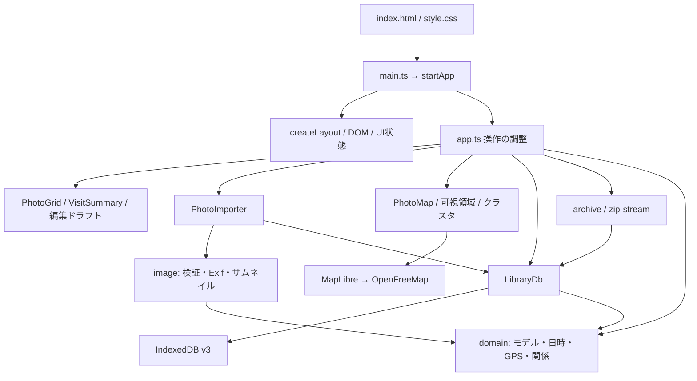

# アーキテクチャ

## 構成

React等のUIフレームワークを使わない、TypeScript strictのクライアントアプリです。DOMを組み立てるプレゼンテーション層と、Domain・取り込み・保存アダプターを分離したモジュラーモノリスです。Nodeは開発/ビルド用で、製品の保存先サーバーではありません。

## 責務と主要モジュール

| 層 | 実装 | 責務 |
|---|---|---|
| 起点 | [main.ts](../../src/main.ts)、[app.ts](../../src/presentation/app.ts) | イベント接続、状態の調整、再読み込みと描画 |
| Domain | [model.ts](../../src/domain/model.ts)、[gps.ts](../../src/domain/gps.ts)、[time.ts](../../src/domain/time.ts)、[corrections.ts](../../src/domain/corrections.ts)、[visits.ts](../../src/domain/visits.ts)、[map.ts](../../src/domain/map.ts) | Zodモデル、関係整合性、証拠を失わない日時/GPS、GeoJSON化 |
| Application | [import-photos.ts](../../src/application/import-photos.ts) | 最大2件の上限付き準備、入力順の重複再確認・原子保存・進捗を調整 |
| Infrastructure | [storage.ts](../../src/infrastructure/storage.ts) | IndexedDB、移行、原子的な保存/競合/内部Undo |
| Infrastructure | [archive.ts](../../src/infrastructure/archive.ts)、[zip-stream.ts](../../src/infrastructure/zip-stream.ts) | ZIP検証、書き出し、衝突分類、ID再割当て |
| Infrastructure | [image.ts](../../src/infrastructure/image.ts)、[basemap.ts](../../src/infrastructure/basemap.ts) | 画像と地図配信の境界 |
| Presentation | [layout.ts](../../src/presentation/layout.ts) | 既存HTMLの再配置、drawer/タブ/モーダル、フォーカス、可視領域通知 |
| Presentation | [photo-grid.ts](../../src/presentation/photo-grid.ts)、[visit-summary.ts](../../src/presentation/visit-summary.ts)、[visit-view.ts](../../src/presentation/visit-view.ts) | 仮想一覧、概要、撮影期間と関連写真の表示用集計 |
| Presentation | [map.ts](../../src/presentation/map.ts)、[map-viewport.ts](../../src/presentation/map-viewport.ts)、[map-spider-layout.ts](../../src/presentation/map-spider-layout.ts) | 地図ソース、選択、カメラ、一時的な画面座標配置 |
| Presentation | [visit-photo-editor.ts](../../src/presentation/visit-photo-editor.ts)、[photo-album-editor.ts](../../src/presentation/photo-album-editor.ts) | 両方向の複数所属編集。各draftモジュールは未保存選択を保持 |
| Presentation | [photo-correction-draft.ts](../../src/presentation/photo-correction-draft.ts)、[error-notice.ts](../../src/presentation/error-notice.ts) | 写真別の補正ドラフト、障害の優先表示 |
| Presentation | [backup-capacity.ts](../../src/presentation/backup-capacity.ts) | 保存件数と既存ZIP上限の表示文言。`LibraryDb.backupCounts()`の読取結果を使い、保存可否を新たに制御しない |

## 起動とデータ経路

1. `index.html`から`src/main.ts`を読み、`startApp()`が`createLayout()`と`ErrorNotice`を作る。
2. DB読み込みが完了するまでworkspaceをinert/disabledにし、`LibraryDb.open()`でv3へ接続する。blocked/versionchangeを登録する。
3. `render()`→`renderLibrary()`がTrip/Photo/Visit/リンクを取得。写真とアルバムの集合をメモリー上で索引化する。
4. Trip・論理削除・検索条件から表示対象を作り、`PhotoGrid`、アルバムカード、`PhotoMap.update()`へ渡す。通常の一覧と地図の写真検索条件は共通。
5. 変更はDB APIへ送り、確定後に`render()`する。所属の応答不明はoperationIdで状態を確認する。

## 状態管理

外部の状態管理ライブラリや履歴ルーターはありません。`app.ts`が選択ID、Trip、検索、アルバム限定モード、戻り先/スクロール、保存状態、取り込み状態を保持します。`layout.ts`は表示容器とナビゲーションを保持し、離脱は`onNavigate`へ集約します。編集draftは保存データと別です。

UI状態は主にメモリー上であり、再読み込み後のドラフト/選択/検索の永続復帰は保証しません。非同期サムネイルや候補には世代/選択IDの確認があり、Object URLは表示終了時に解放します。

2026-11-22の改善では、`app.ts`がアルバム名・GPS/日時補正の編集開始時の期待値を保持し、保存APIが同一トランザクション内で比較します。補正ドラフトは保存確定した送信項目だけ同期します。競合照会の古い応答は対象ID・編集世代・DOM接続状態で除外します。バックアップ件数照会は取り込み開始を待たせず、失敗しても件数を0と断定しません。DB/ZIPのレコード・バージョンやDomainの意味は変えません。詳細は[UI/UX](UI_UX.md)と[保存仕様](STORAGE_AND_BACKUP.md)を参照します。

## 依存ライブラリ

[package.json](../../package.json)の本番依存は`maplibre-gl 6.18.0`、`exifreader 4.54.0`、`fflate 0.8.3`、`zod 4.6.7`です。現行ZIP処理の正本は独自の`zip-stream.ts`で、依存宣言だけから利用経路を推測しません。`exifr`、`heic-to/csp`、`@su-engineering/heic`等は開発/spikeとVite optimizeDepsにも現れますが、現行のHEICサムネイル対応を意味しません。[ライセンス検査](PUBLICATION_REVIEW.md)を参照してください。

今回追加した責務・状態管理の確認元実装Git HEAD: `a493c20509dea1654434bf05ac8e8986da846fce`

2026-11-22の取り込み高速化では、Application内の固定窓と入力/復号予算で先行準備を制御します。保存APIや画像生成設定は変えず、エラー・中断時に準備を回収してから終了します。Worker、依存、通信先は追加しません。[取り込み仕様](IMPORT_AND_PHOTOS.md)・[検証記録](../import-performance-2026-11-22.md)を参照してください。

今回の変更前基準Git HEAD: `4ad902d6adef8c3d1b72e7d44063a25f74e2dd4e`

## 2026-11-22 限定JPEG経路のWorker

Applicationが長辺で拒否された60MP以下のJPEGを識別し、[automatic-jpeg.ts](../../src/infrastructure/automatic-jpeg.ts)がWorkerの起動・5秒期限・中断・返却検証を管理します。[large-jpeg-source.ts](../../src/infrastructure/large-jpeg-source.ts)は入力構造/Exifの予算検証、[Worker](../../src/infrastructure/automatic-jpeg.worker.ts)は元Exifの解析とImageDecoder/OffscreenCanvasによる表示用画像作成を担当します。[protocol](../../src/infrastructure/automatic-jpeg-protocol.ts)は結果と上限・案内を共有します。新しい依存や外部通信はありません。

原本バッファをWorkerへ転送する前にSHA/バイト数を確定します。新経路は既存復号予算を全量予約して通常復号とも排他にし、Workerは結果送信前にFrame/Decoderをcloseします。timeout/通信異常/稼働中の中断ではterminateし、ページ内の処理停止フラグで次の取り込みを拒否します。このフラグは永続データではありません。native内部の解放完了を保証する仕組みではないことを[検証記録](../automatic-large-jpeg-2026-11-22.md)へ残します。

今回の自動取り込み変更前基準Git HEAD: `22521bdb8e7ea9f944251039d185b221da69c102`

今回の自動取り込み実装・検証の確認元Git HEAD: `9dcef54e80cacc4e2be5d7aa3d0ba395a917d396`
