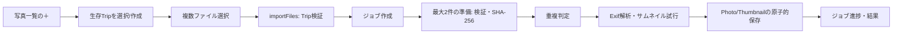

# 写真取り込み・解析・表示

実装: [PhotoImporter](../../src/application/import-photos.ts)、[image.ts](../../src/infrastructure/image.ts)、[storage.ts](../../src/infrastructure/storage.ts)、[取り込みUI](../../src/presentation/app.ts)。

## 入口と流れ

旅行がない/未選択/旅行未設定の写真を閲覧中の場合、作成または選択を要求します。`importFiles()`も非nullで生存するTripをジョブ作成前に検証。開始時のTrip IDを固定し、途中の旅行選択で保存先を変更しません。低層`savePhoto`/旧データ復元のnullable条件は廃止していません。

## 形式・ファイル制限

拡張子やブラウザが渡すMIMEを信用せず、`inspectImage()`で実バイト列の署名とヘッダーを検査します。ファイル名はbasenameへ制限し、制御文字を除去/長さ制限後、モデルでも検証します。

| 形式 | バイト上限 | 宣言寸法の上限 | サムネイル復号 |
|---|---|---|---|
| JPEG | 64MiB | 100MP / 1辺12000px | 60MP / 1辺10000pxまで |
| JPEG・自動縮小の追加経路 | 64MiB | 長辺12000px超、総画素60MP以下の限定形式 | 専用Workerで縮小を要求し、返却Frameと出力を検証。下記参照 |
| PNG / WebP | 20MiB | 12MP / 1辺8192px | 同じ上限内で試行 |
| HEIC / HEIF | 20MiB | 取得できた寸法等を検証。万能なコンテナ検証ではない | 現行は安全な復号未対応として失敗 |

空、不正ヘッダー、過大なサイズ/宣言寸法、未対応署名等を拒否します。従来経路のJPEGはメタデータ取り込み可能でも別の復号上限を超える場合があり、そのときはサムネイルなしの部分成功になり得ます。追加経路の失敗ではPhoto/Thumbnailを保存しません。HEIC/HEIFもメタデータが解析できることと、画像を表示できることを区別します。

## SHA-256と重複

元バイト列全体をSHA-256化し、`findByHash()`で既存Photoを調べます。既定はスキップ。設定`allowDuplicateAcrossTrips`がtrueで、同一ハッシュの既存写真すべてが今回と別旅行の場合のみ、新IDで追加できます。同じ旅行内は許可しません。ごみ箱にある既存Photoもハッシュ照会の対象です。

`savePhoto()`でもトランザクション内で重複/Tripの生存を再検証します。既存写真の補正/所属/サムネイルを上書きする「再取り込み更新」ではありません。

## 元情報とサムネイル

`parseMetadata()`はExifReaderでExifを読み、GPSタグ、DateTimeOriginal/OffsetTimeOriginal等の関連値、orientation、issuesを保存用に整理します。解析エラーをissuesへ残す場合があり、すべてのExifタグを無加工で保存する仕様ではありません。

GPSは測地系の証拠で確認済み/参考/不可を区別し、日時は元の時計と時差を別々に保持します。[位置仕様](MAP_AND_GEO.md)と[モデル](DATA_MODEL.md)を参照してください。

`makeThumbnail()`は長辺512px以下のJPEG（quality 0.82、1MiB以下）をCanvasで生成します。JPEG/PNGはブラウザのExif orientation適用を利用し、WebPは別途変換します。ブラウザ間で同一挙動を全面保証していません。ImageBitmapをcloseし、元バイト列をDBへ保存しません。

## 進捗・中断・部分成功

`ImportJob`はtotal/processed/state/lastError等を保存。各`FileOutcome`は`imported`、`partial`、`skipped-duplicate`、`failed`、`cancelled`で、進捗callbackと結果画面に渡します。個別結果一覧自体は永続ストアではありません。

`cancel()`は未保存分の中断です。保存開始前の準備結果は破棄し、既に開始したDB保存は確定し得ます。既存Photoをロールバック削除しません。現在処理中の1枚をあらゆる段階で即座に止める保証もありません。写真ごとにPhoto/Thumbnailを一体保存し、次の進捗を保存します。

取り込みviewを閉じても同じページ上の進捗/結果へ戻れます。ページ再読み込み後に元Fileや処理全体を自動再開する仕様ではありません。`markInterruptedJobs()`は内部にありますが、現行起動経路には呼び出しがなく、終了時のジョブ状態自動訂正は未接続です。

## 失敗と再確認

1枚の検証/解析/保存失敗はそのファイルのfailedとなり、処理可能な次ファイルへ進みます。従来経路でサムネイル生成だけ失敗してメタデータ保存が成功した場合はpartialです。自動経路のtimeout/通信異常は全体を止めます。ジョブ状態の保存自体の失敗は全体のエラーとしてUIへ伝わり得るため、失敗表示だけで「何も保存されていない」と断定しません。

元写真を別保管し、必要なら一覧で保存結果を確認して再選択します。再取り込み時も既存ハッシュはスキップされ、失敗サムネイルの自動再生成や原本復元を行う機能ではありません。

## 2026-11-22 結果計上と進捗保存の分離

ファイル処理は1件の`FileOutcome`を返し、その後に`processed`を1だけ増やしてジョブ進捗を保存します。重複スキップ直後に進捗保存が失敗しても、同じ写真をfailedへ再分類したり二重計上しません。ジョブ保存・進捗callbackの失敗はファイル解析のcatchで吸収せず全体へ伝え、完了とは表示しません。確定済みPhotoは削除せず、利用者へ一覧で保存結果を確認する案内を残します。

バックアップ件数の照会は取り込み開始を待たせません。照会待ちによって開始直後の中断要求をリセットする待ち窓を作りません。起動時の自動`markInterruptedJobs()`は追加しません。

根拠: [取り込み](../../src/application/import-photos.ts)、[失敗注入単体試験](../../tests/unit/safety-ux.test.ts)、[中断E2E](../../tests/e2e/phase4-interruption.spec.ts)。

今回変更の確認基準Git HEAD: `26093c16cec1924c8110efe5f932bd7159a8ca13`

## 2026-11-22 上限付きの並行準備

準備中と保存待ちを合わせて最大2件の固定窓を使います。読込・検証・ハッシュ・Exif・サムネイルを先行準備し、Photo/Thumbnailの保存、結果計上、Job進捗保存は入力順で1件ずつ行います。窓を進めるのはその進捗保存と通知が成功した後です。`PhotoImporter(db, 1)`は比較検証用の逐次準備で、通常UIは既定の2を使います。

読込前に入力バッファ合計64MiB、復号前に宣言画素合計60MPの内部予算を確保します。大きい入力は待機して直列化し、入力を新しく拒否する上限ではありません。これはブラウザ全体のメモリー上限ではなく、バイト列の一時コピー、デコーダー内部、GCのピークは別です。復号対象外の大JPEG/HEIC等は予算待ちで停止せず、従来の検証・部分成功へ進みます。形式別上限・512px・JPEG品質・向き処理は変更しません。

準備時の重複照会に加え、入力順の保存直前にも最新DBを照会します。同一バッチの先行入力が保存できた場合だけ後の同じ画像をスキップし、先行保存が失敗した場合は後の入力を処理できます。`savePhoto()`内の原子的な重複/Trip生存検証も維持します。

中断後は窓を補充せず、先読み済みの写真を新たに保存しません。すでに開始した保存は確定し得ます。進捗保存・callback失敗は全体へ伝え、確定済み写真を保持し、準備中の処理を回収してから終了します。終了後の保存や通知は残しません。

根拠: [取り込み](../../src/application/import-photos.ts)、[制御単体試験](../../tests/unit/import-pipeline.test.ts)、[ブラウザ安全試験](../../tests/e2e/import-pipeline.spec.ts)、[計画と検証](../import-performance-2026-11-22.md)。DB v3/ZIP v2と保存形式は変更なし。

今回の変更前基準Git HEAD: `4ad902d6adef8c3d1b72e7d44063a25f74e2dd4e`

## 2026-11-22 原本選択だけで大きなJPEGを取り込む限定経路

`ImageDimensionsError`から、JPEG・長辺12000px超・60MP以下だけを[厳格な構造検査](../../src/infrastructure/large-jpeg-source.ts)と[専用Worker](../../src/infrastructure/automatic-jpeg.worker.ts)へ渡します。8bit/3成分/単一scan baselineに限定し、Exif参照・ヘッダー予算も検証します。元SHA/バイト数は転送前に確保し、元Exifの日時・GPS・向きを保持します。原本の修正・保存・送信はありません。

復号予算60MPを全量予約して通常復号とも排他にし、入力64MiB予算も維持します。ImageDecoderへ512pxの縮小を要求しますが、希望値は内部メモリーの保証ではありません。返却Frameのcoded/display寸法は100万画素以下・各辺8192以下、visibleRect/向きも検証してから512px JPEGを作ります。メイン側も返却スキーマ・画像を検証します。`inspectImage()`とZIP検証を緩めず、無制限のfallbackを追加しません。

未対応・過大Frame・不正構造はfailed、Photo/Thumbnail未保存で次入力へ進みます。timeout（5秒）・Worker/通信異常ではJobをinterruptedとして記録・通知し、ページ再読み込みまで全取り込みを拒否します。Job書き込み等も失敗した場合、interruptedの保存は保証せず、再読込の主エラーと二次失敗causeを保持します。稼働中Workerの中断/異常終了でもnativeの即時解放は保証できないため、再読込まで次の取り込みを止めます。

通常経路のpartialは維持します。長辺12000px超・64MP等は今回対象外です。詳細な受け入れ条件、実測、未確認は[検証記録](../automatic-large-jpeg-2026-11-22.md)へ。

今回の自動取り込み変更前基準Git HEAD: `22521bdb8e7ea9f944251039d185b221da69c102`

今回の自動取り込み実装・検証の確認元Git HEAD: `9dcef54e80cacc4e2be5d7aa3d0ba395a917d396`
