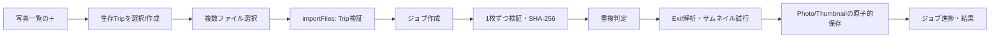

# 写真取り込み・解析・表示

実装: [PhotoImporter](../../src/application/import-photos.ts)、[image.ts](../../src/infrastructure/image.ts)、[storage.ts](../../src/infrastructure/storage.ts)、[取り込みUI](../../src/presentation/app.ts)。

## 入口と流れ

旅行がない/未選択/旅行未設定の写真を閲覧中の場合、作成または選択を要求します。`importFiles()`も非nullで生存するTripをジョブ作成前に検証。開始時のTrip IDを固定し、途中の旅行選択で保存先を変更しません。低層`savePhoto`/旧データ復元のnullable条件は廃止していません。

## 形式・ファイル制限

拡張子やブラウザが渡すMIMEを信用せず、`inspectImage()`で実バイト列の署名とヘッダーを検査します。ファイル名はbasenameへ制限し、制御文字を除去/長さ制限後、モデルでも検証します。

| 形式 | バイト上限 | 宣言寸法の上限 | サムネイル復号 |
|---|---|---|---|
| JPEG | 64MiB | 100MP / 1辺12000px | 60MP / 1辺10000pxまで |
| PNG / WebP | 20MiB | 12MP / 1辺8192px | 同じ上限内で試行 |
| HEIC / HEIF | 20MiB | 取得できた寸法等を検証。万能なコンテナ検証ではない | 現行は安全な復号未対応として失敗 |

空、不正ヘッダー、過大なサイズ/宣言寸法、未対応署名等を拒否します。JPEGはメタデータ取り込み可能でも別の復号上限を超える場合があり、そのときはサムネイルなしの部分成功になり得ます。HEIC/HEIFもメタデータが解析できることと、画像を表示できることを区別します。

## SHA-256と重複

元バイト列全体をSHA-256化し、`findByHash()`で既存Photoを調べます。既定はスキップ。設定`allowDuplicateAcrossTrips`がtrueで、同一ハッシュの既存写真すべてが今回と別旅行の場合のみ、新IDで追加できます。同じ旅行内は許可しません。ごみ箱にある既存Photoもハッシュ照会の対象です。

`savePhoto()`でもトランザクション内で重複/Tripの生存を再検証します。既存写真の補正/所属/サムネイルを上書きする「再取り込み更新」ではありません。

## 元情報とサムネイル

`parseMetadata()`はExifReaderでExifを読み、GPSタグ、DateTimeOriginal/OffsetTimeOriginal等の関連値、orientation、issuesを保存用に整理します。解析エラーをissuesへ残す場合があり、すべてのExifタグを無加工で保存する仕様ではありません。

GPSは測地系の証拠で確認済み/参考/不可を区別し、日時は元の時計と時差を別々に保持します。[位置仕様](MAP_AND_GEO.md)と[モデル](DATA_MODEL.md)を参照してください。

`makeThumbnail()`は画像を順次処理し、長辺512px以下のJPEG（quality 0.82、1MiB以下）をCanvasで生成します。JPEG/PNGはブラウザのExif orientation適用を利用し、WebPは別途変換します。ブラウザ間で同一挙動を全面保証していません。ImageBitmapをcloseし、元バイト列をDBへ保存しません。

## 進捗・中断・部分成功

`ImportJob`はtotal/processed/state/lastError等を保存。各`FileOutcome`は`imported`、`partial`、`skipped-duplicate`、`failed`、`cancelled`で、進捗callbackと結果画面に渡します。個別結果一覧自体は永続ストアではありません。

`cancel()`は未処理分の中断です。既に保存されたPhotoをロールバック削除しません。現在処理中の1枚をあらゆる段階で即座に止める保証もありません。写真ごとにPhoto/Thumbnailを一体保存し、次の進捗を保存します。

取り込みviewを閉じても同じページ上の進捗/結果へ戻れます。ページ再読み込み後に元Fileや処理全体を自動再開する仕様ではありません。`markInterruptedJobs()`は内部にありますが、現行起動経路には呼び出しがなく、終了時のジョブ状態自動訂正は未接続です。

## 失敗と再確認

1枚の検証/解析/保存失敗はそのファイルのfailedとなり、処理可能な次ファイルへ進みます。サムネイル生成だけ失敗してメタデータ保存が成功した場合はpartialです。ジョブ状態の保存自体の失敗は全体のエラーとしてUIへ伝わり得るため、失敗表示だけで「何も保存されていない」と断定しません。

元写真を別保管し、必要なら一覧で保存結果を確認して再選択します。再取り込み時も既存ハッシュはスキップされ、失敗サムネイルの自動再生成や原本復元を行う機能ではありません。

仕様の確認元Git HEAD: `989eae47f3ae96fa557b97eb5d7cb63e47e77f9e`
