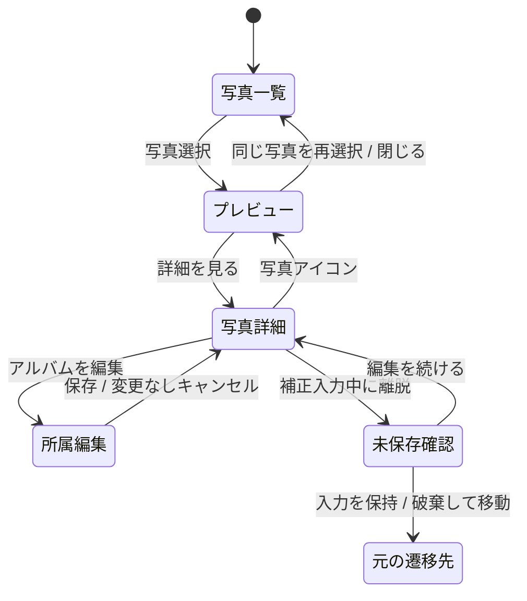
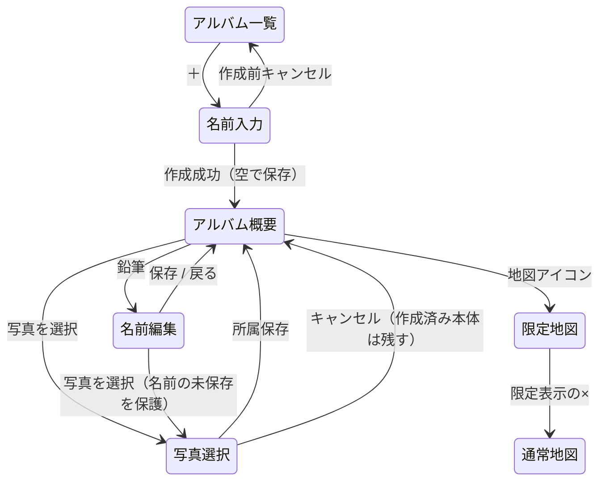
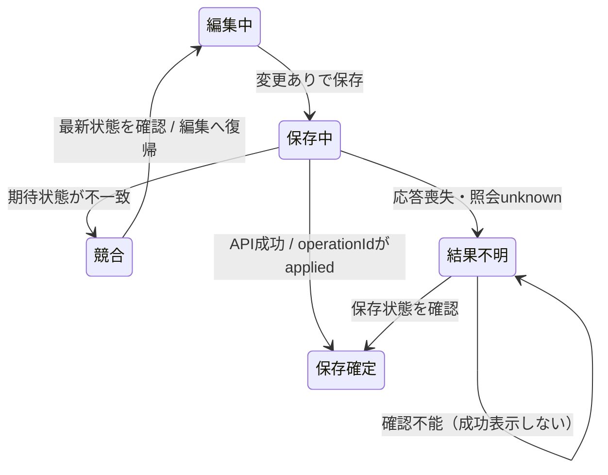

# UI/UXと画面状態

実装は[layout.ts](../../src/presentation/layout.ts)、[app.ts](../../src/presentation/app.ts)、[style.css](../../src/style.css)。画面の見た目だけでなく、編集ドラフト・検索・保存済みデータを別の状態として扱います。

## ワークスペース

- PC: 地図を全面に置くMap-first。左端中央のタブで写真/アルバムdrawerを開閉。狭いPCでは詳細を開く際にdrawerを閉じる条件があります。開閉だけでは検索や選択を消さず、原則カメラを動かしません。
- モバイル: 下部の地図・写真・アルバムの3タブ。PC用の引き出しタブは追加しません。写真プレビューはコンパクトな下部パネル、詳細/編集はスクロールできる画面です。
- 共通ヘッダー: アプリ名、旅行セレクター、旅行管理、アプリ管理。写真追加はヘッダー/管理の独立行ではなく、写真一覧の件数行右の＋です。
- 写真/アルバムの件数と新規作成アイコンは一覧タブ直下。スクロール時もタブの下に留まり、44pxの操作領域を確保します。

## 写真閲覧

選択はプレビューと選択リングの変更です。ズームは維持し、不可視の場合のみパン。明示的な地図アイコンとは区別します。写真詳細の操作列は写真/地図/ごみ箱。ごみ箱は詳細編集に隠さず、必ず写真本体の移動確認を開きます。補正の入力欄は「詳細情報・編集」内に保持し、通常プレビューへ大量表示しません。

アルバムの全写真一覧から開いた場合は、親アルバム/写真一覧とスクロール位置を戻り先に記憶します。×は表示容器を閉じ、←は親の閲覧画面へ戻る操作です。

## アルバム作成・編集

空アルバムは名前・写真0枚・「写真を選択」を中心に表示し、大きな画像なし表紙や重複説明を作りません。通常アルバムは写真、件数、写真由来の日付/期間を優先します。旧代表地点/手動日時を通常UIへ戻しません。

[VisitPhotoEditor](../../src/presentation/visit-photo-editor.ts)は1つの安定した日時順グリッド。画像本体が選択ON/OFF、右上がチェック表示、別のプレビュー操作で確認します。検索/スクロールでドラフトを失わず、保存/キャンセルと追加・解除件数をフッターに置きます。他アルバム所属をカードに長文表示しません。

[PhotoAlbumEditor](../../src/presentation/photo-album-editor.ts)はPCの中央dialogとモバイルの編集ビュー。同一Tripのアルバムを検索し、現在の所属/その他を確認して一括保存します。ごみ箱所属は対象外リンクとして保持します。

## 写真追加と旅行

写真追加ダイアログは「旅行が必要」「未選択」「選択済み」「取り込み中」「完了」「エラー」の状態を切り替えます。通常は追加先、写真選択、件数、取り込み操作、原本非保存の注意と短いバックアップ件数要約を表示します。形式/重複/HEIC/中断の補足は展開領域に移します。処理中に閉じても進捗/結果へ戻る入口を残します。

旅行0件ならファイル保存を始めず旅行作成へ。旅行作成は名前と作成/キャンセルを基本とし、保存中/結果不明では二重送信や閉じる操作を制限します。既存の旅行未設定写真は存在する場合だけ互換選択項目として表示します。

## 管理と確認画面

アプリ管理はバックアップ、復元、ごみ箱、地図設定とプライバシー等。Undo履歴一覧/実行UIはありません。ZIP未選択では復元不可。通常保存と直接保存を区別し、重要な原本非保存の注意を残します。

写真/アルバム/旅行のごみ箱移動は共通確認へ集約します。写真本体と所属解除を混同しません。ごみ箱を開くことと、ごみ箱へ移すことも別操作です。ごみ箱からの復元は既存データを保持したまま復帰させる操作です。

## 戻る・閉じる・余白

地図の純粋な余白クリックは、一時候補/展開、閲覧詳細/概要、PC drawerの順に最前面の1層だけ閉じます。ドラッグ、ズーム、ダブルクリック、マーカー、出典/操作ボタン等を除外します。アルバム限定モードと検索は解除しません。新しい入力/操作があれば古い遅延余白クリックを無効にします。

未保存編集、保存中、保存結果不明、管理/写真追加dialogを余白クリックで黙って閉じません。Escape/×も各編集画面の離脱条件を通します。モーダルは背景inert、Tab管理、閉じた後のフォーカス復帰を持ちます。アイコンにはaria-label/titleを設定します。

## 保存状態

競合ダイアログを閉じても理由と確認入口を残します。保存確認が必要な状態を単なる成功通知で隠しません。写真別補正ドラフトは画面再描画で保持しますが、ページ再読み込み後まで永続化する仕様ではありません。

## 2026-11-22 保存入力・競合・キーボード操作

GPSと日時補正は別々の送信項目として扱います。確定した項目のみドラフトの保存済み基準へ同期し、数値表記の正規化による偽の未保存を残しません。保存中の追加入力と他方の未保存補正は保持します。失敗時も入力を保持します。

アルバム名と同じ補正欄の他画面変更は競合として拒否します。単純な再保存では新しい保存値を上書きしません。「最新状態を確認」で保存値を表示し、別の「この保存値を基準に編集を続ける」で明示的に基準を採用してから入力を確認・編集します。確認は入力を破棄せず、古い画面への遅延応答は現在の編集へ適用しません。キーボードで確認した場合は採用ボタン、その後は該当入力へフォーカスを戻します。保存確定後の表示失敗は、保存済みと表示更新失敗を分けて案内します。

管理・写真取り込み選択・復元前に全旅行/ごみ箱を含むバックアップ件数の短い要約を出し、全5種件数・64 MiB通常保存/256 MiB直接保存・サイズ予測の限界は「ZIP上限と保存方法」で展開します。接近/超過/選択分の超過可能性は常時表示します。警告は新しい保存禁止条件ではありません。

[PhotoGrid](../../src/presentation/photo-grid.ts)は仮想DOM更新時に写真IDでfocus({preventScroll:true})を復帰します。手動スクロールで対象が描画範囲外、フィルターで消失、0件になった場合は一覧容器へ戻し、スクロールを巻き戻しません。一覧外へ移動したフォーカスは奪いません。Tab/Shift+Tabは未描画の次/前写真へ続き、全体の端では通常のTab移動へ戻ります。キーボード移動時はsticky見出しに隠れないよう一覧内を必要分スクロールします。フォーカス移動だけで写真選択や地図パンを実行しません。

根拠: [補正ドラフト](../../src/presentation/photo-correction-draft.ts)、[画面処理](../../src/presentation/app.ts)、[回帰試験](../../tests/e2e/safety-ux-improvements.spec.ts)。

今回変更の確認基準Git HEAD: `26093c16cec1924c8110efe5f932bd7159a8ca13`

## 2026-11-22 大きなJPEGも原本だけを選ぶ

既存の写真選択→取り込む→結果の操作を維持します。対応する大JPEGでは自動で表示用画像を作り、成功は通常と同じ「追加」です。専用設定やコピー選択はありません。詳細設定に元写真を変更しない旨の補足を置きます。

未対応/安全上限/読取失敗はファイル別の理由を確認する案内とし、同じ写真を選び直せば解決すると断定しません。通常経路の部分成功は「写真情報のみ追加」と区別します。画像なしの詳細は「表示用画像は保存されていません。写真情報は確認できます。」と表示し、未実装の再生成を約束する旧文言を訂正します。

timeout/通信異常と稼働中の自動処理の中断は、次の取り込み前に再読み込みが必要です。中断は失敗と区別し、保存済み写真が残る案内を維持します。自動再読み込みやドラフト破棄は行いません。[取り込み仕様](IMPORT_AND_PHOTOS.md)・[テスト](../../tests/e2e/automatic-large-jpeg.spec.ts)を参照。

今回の自動取り込み変更前基準Git HEAD: `22521bdb8e7ea9f944251039d185b221da69c102`

今回の自動取り込み実装・検証の確認元Git HEAD: `9dcef54e80cacc4e2be5d7aa3d0ba395a917d396`

## 2026-11-22 背景地図の選択

左下の「レイヤー」はPCでdrawerの右へ追従する。モバイルは地図タブ内に配置し、下部3タブと写真プレビューを避ける。701〜1100pxで詳細と一覧の両方が開いている場合は、既存の詳細表示時と同様に一覧を閉じて地図の操作領域を確保する。検索・選択・編集中の詳細は保持する。4種類をradioで選び、用途・衛星画像の年代/画質・配信先を表示する。選択中/読込中/失敗と再試行を区別する。

×/Escapeはレイヤーパネルだけを閉じ、入口へフォーカスを戻す。地図余白も最前面の1層だけ閉じる。パネル操作は写真や編集ドラフトを終了しない。写真/アルバム表示設定は既存の管理画面に保持し、背景切替から呼び出さない。選択パネルは写真プレビューより前面に配置し、スクロール中も閉じる操作を保持する。出典はMapLibreの表示を維持してパネル内にも複製し、[可視領域](../../src/presentation/map-viewport.ts)では新しい操作領域も避ける。[UI実装](../../src/presentation/basemap-control.ts)。

今回の背景地図変更前基準Git HEAD: `b3142ba0cefd217ca015f6e8c2236761d6ccfd7e`

今回の世界背景地図の実装・検証の確認元Git HEAD: `d12df590a808604414a8a4ce6d3a2b02422aadbb`

## 2026-11-22 地図選択をコンパクト表示へ

入口は現在の種類の説明用プレビュー付き「レイヤー」。展開時は4つのプレビューと短い名称を横並びにし、長い説明・配信情報・出典は「詳細・出典」へまとめる。現状の世界画像は衛星モザイクなので短名は「衛星写真」、アクセシブル名は従来の「航空・衛星写真」を維持する。CSSの説明用模様であり、Googleの画像/アイコンや閲覧地点の画像を転載しない。

mouseかつhover可能な細かいポインターでは、入口のpointerenterで展開する。フォーカス/カメラ/背景種類/検索/drawerは変更しない。入口→パネルの隙間を渡れる220msの猶予を設ける。クリックで固定表示し、固定中/パネル内のフォーカス中はpointerleaveだけで閉じない。タッチはタップ、キーボードは入口→radio。×/Escape/余白は1層だけ終了し、閉じた直後に下の入口が露出しても実ポインター移動前に再展開しない。

狭い画面ではコンパクトな選択を入口の上、上に空間がなければ下へ配置。詳細展開時は安全な上部位置へ置く。閉じる操作と出典への到達、44px操作領域、写真プレビューより前面を維持する。詳細は閉じると折りたたむ。[計画・検証・画質調査](../compact-map-layers-2026-11-22.md)、[実装](../../src/presentation/basemap-control.ts)。

今回のコンパクト選択変更前基準Git HEAD: `444c94ca55798292a9e0abc6faf694bf7509d6b4`

今回のコンパクト選択の実装・検証の確認元Git HEAD: `c01a34d9e5f3af931305431c5340c2b7b23d79b2`

## 2026-11-22 地域航空写真の案内

基本4種類とhover操作は維持し、航空・衛星写真は短い表示「航空・衛星」とする。地域は表示範囲/縮尺で切り替わり、新しい設定画面を増やさない。「詳細・出典」に日本/米国本土・その他世界下地・画像の時点/精細さ/空白の差を説明する。地図帰属を実sourceから表示/複製し、地域の一部取得失敗は写真操作を妨げず取得済み地図を残す。選択パネル内に簡潔な案内と再試行を表示する。

今回地域画像変更前基準Git HEAD: `1fdcb271c166a8fed98238bab63f039110290e65`

今回地域画像の実装・検証の確認元Git HEAD: `7199cdc7329960b059946a216bcead6e50d46cbd`

## 2026-11-23 レイヤー選択をさらに縮小

この節が以前の×付き選択UIを置き換える。入口60px角、パネル304px幅、4つの見本/短名と44px情報アイコンだけを通常表示する。×は設置しない。説明/通信/出典は「地図の詳細・出典」と名付けたsummaryで展開。hover、クリック固定、入口再クリック/余白/Escapeによる終了とフォーカス復帰を維持。タッチでも同じ入口で開閉する。44px以上の操作領域、不透明背景、選択枠、focus-visibleを保つ。[変更・検証](../smaller-layer-controls-2026-11-23.md)。

今回レイヤーUI変更前基準Git HEAD: `cc33039be2a707393a0c21a24bd2f5ead1d00aea`

今回レイヤーUI実装・検証の確認元Git HEAD: `3e2882c6896fb251e199e23ce98f529ce6554d92`

## 2026-11-23 基本4種類と「もっと見る」

基本の4見本・60px入口・304px幅の小型パネルを維持し、右の44px枠は「もっと見る」とする。押すと鉄道/散策/ダークと「地図の詳細・出典」が同じパネル内に展開する。×や別ダイアログは追加しない。追加見本には短い説明があり、基本/追加は同じradio groupで一つだけ選ぶ。

hoverだけでは追加欄・通信・選択・focusを変えない。明示展開では固定表示し、追加候補へfocusを移すが選択は変えない。追加選択中は「もっと見る」を強調して入口にもプレビューを反映する。外側を閉じると追加欄と情報を折りたたむ。再hoverは小型の4つだけ、明示openは現在の追加選択へ到達できるよう展開/focusする。Escape/入口再click/余白の一層終了、タッチ/キーボード、44px以上の操作領域と写真の可視領域回避を維持。[計画・検証](../more-map-layers-2026-11-23.md)。

今回追加地図変更前基準Git HEAD: `7d24340be57d17bbec6237de5df252fef71bb549`

今回追加地図の実装・検証の確認元Git HEAD: `4b7c4382f05f0cc1fab695c00b4870094ca4c7ab`
